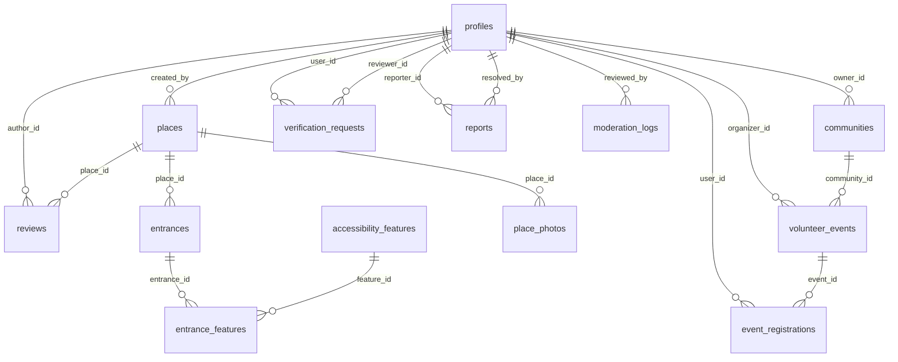

# Database Rangkul

Dokumen ini adalah **sumber kebenaran skema database** untuk tiga fitur Rangkul: informasi aksesibilitas tempat, direktori komunitas, dan volunteer inklusif.

Status: **rencana, belum diimplementasikan.** Belum ada `schema.prisma`, migrasi, atau query backend di repo. Dokumen ini dipakai agar semua kontributor memakai nama tabel, kolom, relasi, status, dan constraint yang sama saat implementasi dimulai.

- Ringkasan entitas dan aturan tingkat arsitektur: [`docs/architecture.md`](./architecture.md) §10.
- Kebutuhan produk: [`docs/product.md`](./product.md).
- Tipe UI saat ini (mock): [`types/place.ts`](../types/place.ts).

---

## 1. Ruang Lingkup

| Fitur | Tabel utama |
|---|---|
| Informasi & navigasi tempat | `places`, `entrances`, `accessibility_features`, `entrance_features`, `place_photos`, `reviews` |
| Direktori komunitas | `communities`, `verification_requests` |
| Volunteer inklusif | `volunteer_events`, `event_registrations` |
| Lintas fitur | `profiles`, `reports`, `moderation_logs` |

Di luar dokumen ini: kode Prisma, migrasi SQL, seed script, server action, dan kebijakan moderasi AI. Semua itu mengikuti dokumen ini saat dikerjakan.

---

## 2. Konvensi

### 2.1 Penamaan

| Lapisan | Aturan | Contoh |
|---|---|---|
| Tabel | `snake_case`, plural | `volunteer_events` |
| Kolom | `snake_case` | `created_at`, `rating_avg` |
| Primary key | selalu `id` | `id` |
| Foreign key | `<entitas>_id` | `place_id`, `author_id` |
| Model Prisma | PascalCase, dipetakan dengan `@@map` | `model VolunteerEvent { @@map("volunteer_events") }` |
| Enum Prisma | PascalCase, nilai `UPPER_SNAKE` | `EventStatus.PUBLISHED` |
| Index | `idx_<tabel>_<kolom>` | `idx_places_status_category` |
| Unique index | `uq_<tabel>_<kolom>` | `uq_reviews_place_author` |
| Foreign key constraint | `fk_<tabel>_<kolom>` | `fk_entrances_place_id` |

Nama identifier tetap bahasa Inggris. Label yang dilihat pengguna tetap bahasa Indonesia dan tidak disimpan sebagai nama kolom.

### 2.2 Tipe & default

| Kebutuhan | Tipe | Default |
|---|---|---|
| Primary key | `uuid` | `gen_random_uuid()` |
| Waktu | `timestamptz` (UTC) | `now()` untuk `created_at` |
| Uang | tidak ada di skema ini | — |
| Rating agregat | `numeric(3,2)` | `0` |
| Rating review | `smallint` | — |
| Koordinat | `numeric(9,6)` | — |
| Flag | `boolean` | `false` |
| Daftar pendek | `text[]` | `'{}'` |
| Struktur bebas | `jsonb` | `'{}'` |
| Urutan | `integer` | `0` |

Aturan tambahan:

- Semua waktu disimpan UTC. Konversi ke `Asia/Jakarta` hanya di lapisan tampilan.
- `updated_at` diisi trigger `set_updated_at()` pada setiap `UPDATE`.
- Soft delete memakai `archived_at timestamptz` untuk konten publik. Baris tidak dihapus fisik kecuali diminta kebijakan retensi.
- Jangan memakai auto-increment yang bisa ditebak untuk ID publik.
- `slug` unik dan stabil. Setelah publikasi, perubahan `slug` wajib disertai redirect.

### 2.3 Enum

Enum memakai tipe enum Postgres, bukan `text` bebas. Penambahan nilai baru dilakukan lewat migrasi `ALTER TYPE ... ADD VALUE` dan harus kompatibel ke belakang.

---

## 3. ERD



Catatan relasi:

- `moderation_logs` dan `reports` merujuk konten secara polimorfik (`content_type` + `content_id`, `target_type` + `target_id`). Tidak ada foreign key fisik ke tabel konten; validitas target dicek di server.
- Tidak ada tabel keanggotaan komunitas. Pendaftaran anggota memakai `communities.join_url` ke grup eksternal.
- `event_registrations.user_id` wajib (bukan nullable). Pendaftaran volunteer selalu butuh login.

---

## 4. Enum

### 4.1 `user_role`

| Nilai | Arti |
|---|---|
| `USER` | Pengguna umum |
| `ORGANIZER` | Penyelenggara kegiatan yang sudah terverifikasi |
| `ADMIN` | Moderator dan admin platform |

### 4.2 `place_category`

`WISATA`, `KULINER`, `TRANSPORTASI`, `IBADAH`, `KESEHATAN`

### 4.3 `content_status`

Dipakai `places.status`.

`PENDING`, `PUBLISHED`, `REJECTED`, `ARCHIVED`

### 4.4 `review_status`

`PENDING`, `PUBLISHED`, `REJECTED`

### 4.5 `feature_value`

`AVAILABLE`, `NOT_AVAILABLE`, `UNKNOWN`

### 4.6 `community_status`

`PENDING`, `VERIFIED`, `REJECTED`, `SUSPENDED`

### 4.7 `event_status`

`DRAFT`, `PENDING`, `PUBLISHED`, `CLOSED`, `REJECTED`

### 4.8 `event_category`

`EVENT_SUPPORT`, `ACCESSIBILITY_AUDIT`, `SOCIAL_ACTIVITY`, `INCLUSIVE_PROGRAM`, `OTHER`

### 4.9 `registration_status`

`PENDING`, `CONFIRMED`, `CANCELLED`

### 4.10 `verification_type` & `verification_status`

| Enum | Nilai |
|---|---|
| `verification_type` | `COMMUNITY`, `ORGANIZER` |
| `verification_status` | `PENDING`, `APPROVED`, `REJECTED` |

### 4.11 `report_*`

| Enum | Nilai |
|---|---|
| `report_target_type` | `PLACE`, `ENTRANCE`, `REVIEW`, `COMMUNITY`, `VOLUNTEER_EVENT` |
| `report_reason` | `INACCURATE`, `SPAM`, `OFFENSIVE`, `DUPLICATE`, `OTHER` |
| `report_status` | `OPEN`, `REVIEWING`, `RESOLVED`, `DISMISSED` |

### 4.12 `moderation_decision`

`APPROVED`, `FLAGGED`, `REJECTED`

---

## 5. Tabel

### 5.1 `profiles`

Profil aplikasi. `id` sama dengan UUID Supabase Auth, bukan auto-increment.

| Kolom | Tipe | Null | Default | Constraint |
|---|---|---|---|---|
| `id` | `uuid` | tidak | — | PK, FK `auth.users(id)` `ON DELETE CASCADE` |
| `email` | `text` | tidak | — | unik lewat `lower(email)` |
| `name` | `text` | tidak | — | panjang 1–80 |
| `role` | `user_role` | tidak | `'USER'` | — |
| `avatar_url` | `text` | ya | — | URL storage |
| `bio` | `text` | ya | — | maksimal 500 karakter |
| `created_at` | `timestamptz` | tidak | `now()` | — |
| `updated_at` | `timestamptz` | tidak | `now()` | trigger |

Index: `uq_profiles_email_lower` pada `lower(email)`, `idx_profiles_role`.

Catatan: role disimpan di database, tidak pernah di cookie atau state client. Perubahan role hanya lewat admin/server.

### 5.2 `places`

| Kolom | Tipe | Null | Default | Constraint |
|---|---|---|---|---|
| `id` | `uuid` | tidak | `gen_random_uuid()` | PK |
| `slug` | `text` | tidak | — | unik, `^[a-z0-9]+(-[a-z0-9]+)*$` |
| `name` | `text` | tidak | — | panjang 2–120 |
| `category` | `place_category` | tidak | — | — |
| `description` | `text` | tidak | — | panjang 20–5000 |
| `address` | `text` | tidak | — | panjang 5–300 |
| `city` | `text` | tidak | — | — |
| `province` | `text` | tidak | — | — |
| `latitude` | `numeric(9,6)` | tidak | — | `-90..90` |
| `longitude` | `numeric(9,6)` | tidak | — | `-180..180` |
| `status` | `content_status` | tidak | `'PENDING'` | — |
| `created_by` | `uuid` | tidak | — | FK `profiles(id)` `ON DELETE RESTRICT` |
| `rating_avg` | `numeric(3,2)` | tidak | `0` | `0..5`, dihitung trigger |
| `review_count` | `integer` | tidak | `0` | `>= 0`, dihitung trigger |
| `published_at` | `timestamptz` | ya | — | wajib terisi saat `PUBLISHED` |
| `archived_at` | `timestamptz` | ya | — | soft delete |
| `created_at` | `timestamptz` | tidak | `now()` | — |
| `updated_at` | `timestamptz` | tidak | `now()` | trigger |

Index:

- `uq_places_slug` (`slug`)
- `idx_places_status_category` (`status`, `category`)
- `idx_places_location` (`province`, `city`)
- `idx_places_name_trgm` GIN (`name gin_trgm_ops`) untuk pencarian
- `idx_places_coordinates` (`latitude`, `longitude`) untuk bounding box

Aturan: `rating_avg` dan `review_count` adalah cache agregat. Jangan menulisnya dari server action; biarkan trigger §7 yang memperbarui.

### 5.3 `entrances`

Satu baris per pintu masuk. Ini pembeda utama produk: kondisi aksesibilitas dinilai per pintu, bukan per bangunan.

| Kolom | Tipe | Null | Default | Constraint |
|---|---|---|---|---|
| `id` | `uuid` | tidak | `gen_random_uuid()` | PK |
| `place_id` | `uuid` | tidak | — | FK `places(id)` `ON DELETE CASCADE` |
| `label` | `text` | tidak | — | panjang 2–80 |
| `notes` | `text` | ya | — | maksimal 1000 karakter |
| `latitude` | `numeric(9,6)` | ya | — | `-90..90` |
| `longitude` | `numeric(9,6)` | ya | — | `-180..180` |
| `is_main` | `boolean` | tidak | `false` | satu per place (partial unique) |
| `photo_url` | `text` | ya | — | — |
| `route_distance_m` | `integer` | ya | — | `> 0` |
| `route_duration_min` | `integer` | ya | — | `> 0` |
| `route_condition` | `text` | ya | — | maksimal 500 karakter |
| `route_steps` | `text[]` | tidak | `'{}'` | maksimal 10 langkah |
| `created_at` | `timestamptz` | tidak | `now()` | — |
| `updated_at` | `timestamptz` | tidak | `now()` | trigger |

Index:

- `idx_entrances_place_id` (`place_id`)
- `uq_entrances_one_main` unik parsial `(place_id) WHERE is_main`
- `idx_entrances_coordinates` (`latitude`, `longitude`)

Aturan: setiap place minimal punya satu entrance sebelum boleh `PUBLISHED`. Jika `is_main` dipindah, trigger/server action harus memastikan hanya satu yang aktif.

### 5.4 `accessibility_features`

Master fasilitas. Tabel sistem yang di-seed, bukan dibuat pengguna.

| Kolom | Tipe | Null | Default | Constraint |
|---|---|---|---|---|
| `id` | `uuid` | tidak | `gen_random_uuid()` | PK |
| `key` | `text` | tidak | — | unik, `^[a-z0-9]+(-[a-z0-9]+)*$` |
| `label` | `text` | tidak | — | — |
| `short_label` | `text` | tidak | — | — |
| `category` | `text` | tidak | — | `entrance`, `building`, `service` |
| `icon` | `text` | tidak | — | nama ikon di `components/ui/icons.tsx` |
| `description` | `text` | tidak | — | — |
| `sort_order` | `integer` | tidak | `0` | — |
| `is_active` | `boolean` | tidak | `true` | — |
| `created_at` | `timestamptz` | tidak | `now()` | — |

Index: `uq_accessibility_features_key` (`key`), `idx_accessibility_features_active` (`is_active`, `sort_order`).

Seed awal mengikuti `ACCESSIBILITY_FEATURES` di `lib/mock/places.ts`: `ramp`, `lift`, `accessible-toilet`, `guiding-block`, `accessible-parking`, `automatic-door`, `wide-entrance`.

### 5.5 `entrance_features`

Sumber kebenaran untuk filter fasilitas. Satu baris per pasangan pintu–fasilitas.

| Kolom | Tipe | Null | Default | Constraint |
|---|---|---|---|---|
| `id` | `uuid` | tidak | `gen_random_uuid()` | PK |
| `entrance_id` | `uuid` | tidak | — | FK `entrances(id)` `ON DELETE CASCADE` |
| `feature_id` | `uuid` | tidak | — | FK `accessibility_features(id)` `ON DELETE RESTRICT` |
| `value` | `feature_value` | tidak | `'UNKNOWN'` | — |
| `notes` | `text` | ya | — | maksimal 300 karakter |
| `updated_by` | `uuid` | ya | — | FK `profiles(id)` `ON DELETE SET NULL` |
| `created_at` | `timestamptz` | tidak | `now()` | — |
| `updated_at` | `timestamptz` | tidak | `now()` | trigger |

Index:

- `uq_entrance_features_pair` (`entrance_id`, `feature_id`)
- `idx_entrance_features_filter` (`feature_id`, `value`)

Aturan: jangan menyimpan daftar fasilitas duplikat di `places`. Filter fasilitas selalu lewat join ke tabel ini. `UNKNOWN` berarti belum dikonfirmasi, bukan "tidak ada".

### 5.6 `place_photos`

| Kolom | Tipe | Null | Default | Constraint |
|---|---|---|---|---|
| `id` | `uuid` | tidak | `gen_random_uuid()` | PK |
| `place_id` | `uuid` | tidak | — | FK `places(id)` `ON DELETE CASCADE` |
| `url` | `text` | tidak | — | URL bucket `place-photos` |
| `alt` | `text` | tidak | `''` | wajib diisi untuk foto informatif |
| `sort_order` | `integer` | tidak | `0` | `>= 0` |
| `created_by` | `uuid` | ya | — | FK `profiles(id)` `ON DELETE SET NULL` |
| `created_at` | `timestamptz` | tidak | `now()` | — |

Index: `idx_place_photos_place_order` (`place_id`, `sort_order`).

### 5.7 `reviews`

| Kolom | Tipe | Null | Default | Constraint |
|---|---|---|---|---|
| `id` | `uuid` | tidak | `gen_random_uuid()` | PK |
| `place_id` | `uuid` | tidak | — | FK `places(id)` `ON DELETE CASCADE` |
| `author_id` | `uuid` | tidak | — | FK `profiles(id)` `ON DELETE CASCADE` |
| `rating` | `smallint` | tidak | — | `1..5` |
| `body` | `text` | tidak | — | panjang 10–2000 |
| `accessibility_note` | `text` | ya | — | maksimal 500 karakter |
| `status` | `review_status` | tidak | `'PENDING'` | — |
| `published_at` | `timestamptz` | ya | — | — |
| `created_at` | `timestamptz` | tidak | `now()` | — |
| `updated_at` | `timestamptz` | tidak | `now()` | trigger |
| `archived_at` | `timestamptz` | ya | — | soft delete |

Index:

- `uq_reviews_place_author` unik parsial `(place_id, author_id) WHERE archived_at IS NULL` — satu review aktif per pengguna per tempat.
- `idx_reviews_place_published` (`place_id`, `status`, `published_at DESC`)
- `idx_reviews_author` (`author_id`)

Aturan: review yang di-`ARCHIVED`/`REJECTED` tidak dihitung ke `rating_avg`. Edit review tidak membuat baris baru; update baris yang sama dan kembalikan status ke `PENDING` bila isi berubah.

### 5.8 `communities`

| Kolom | Tipe | Null | Default | Constraint |
|---|---|---|---|---|
| `id` | `uuid` | tidak | `gen_random_uuid()` | PK |
| `slug` | `text` | tidak | — | unik |
| `name` | `text` | tidak | — | panjang 2–120 |
| `description` | `text` | tidak | — | panjang 20–3000 |
| `province` | `text` | tidak | — | — |
| `city` | `text` | tidak | — | — |
| `focus` | `text[]` | tidak | `'{}'` | maksimal 8 item |
| `contact` | `text` | tidak | — | email atau nomor telepon |
| `socials` | `jsonb` | tidak | `'{}'` | kunci: `instagram`, `facebook`, `website` |
| `join_url` | `text` | tidak | — | URL grup/tautan pendaftaran eksternal |
| `logo_url` | `text` | ya | — | bucket `community-logos` |
| `status` | `community_status` | tidak | `'PENDING'` | — |
| `owner_id` | `uuid` | tidak | — | FK `profiles(id)` `ON DELETE RESTRICT` |
| `verified_at` | `timestamptz` | ya | — | — |
| `verified_by` | `uuid` | ya | — | FK `profiles(id)` `ON DELETE SET NULL` |
| `archived_at` | `timestamptz` | ya | — | — |
| `created_at` | `timestamptz` | tidak | `now()` | — |
| `updated_at` | `timestamptz` | tidak | `now()` | trigger |

Index:

- `uq_communities_slug` (`slug`)
- `idx_communities_status` (`status`)
- `idx_communities_location` (`province`, `city`)
- `idx_communities_focus` GIN (`focus`)
- `idx_communities_name_trgm` GIN (`name gin_trgm_ops`)

Aturan: `status = 'VERIFIED'` wajib punya `verified_at` dan `verified_by`. Hanya komunitas `VERIFIED` yang tampil di direktori publik.

### 5.9 `volunteer_events`

| Kolom | Tipe | Null | Default | Constraint |
|---|---|---|---|---|
| `id` | `uuid` | tidak | `gen_random_uuid()` | PK |
| `slug` | `text` | tidak | — | unik |
| `organizer_id` | `uuid` | tidak | — | FK `profiles(id)` `ON DELETE RESTRICT`, role `ORGANIZER`/`ADMIN` |
| `community_id` | `uuid` | ya | — | FK `communities(id)` `ON DELETE SET NULL` |
| `title` | `text` | tidak | — | panjang 5–150 |
| `description` | `text` | tidak | — | panjang 20–5000 |
| `category` | `event_category` | tidak | — | — |
| `location_name` | `text` | tidak | — | — |
| `address` | `text` | tidak | — | — |
| `latitude` | `numeric(9,6)` | ya | — | `-90..90` |
| `longitude` | `numeric(9,6)` | ya | — | `-180..180` |
| `starts_at` | `timestamptz` | tidak | — | — |
| `ends_at` | `timestamptz` | tidak | — | `> starts_at` |
| `requirements` | `text` | ya | — | maksimal 2000 karakter |
| `slots` | `integer` | tidak | — | `> 0` |
| `registered_count` | `integer` | tidak | `0` | `0..slots`, dihitung trigger |
| `status` | `event_status` | tidak | `'DRAFT'` | — |
| `published_at` | `timestamptz` | ya | — | — |
| `archived_at` | `timestamptz` | ya | — | — |
| `created_at` | `timestamptz` | tidak | `now()` | — |
| `updated_at` | `timestamptz` | tidak | `now()` | trigger |

Index:

- `uq_volunteer_events_slug` (`slug`)
- `idx_volunteer_events_status_start` (`status`, `starts_at`)
- `idx_volunteer_events_organizer` (`organizer_id`)
- `idx_volunteer_events_community` (`community_id`)
- `idx_volunteer_events_title_trgm` GIN (`title gin_trgm_ops`)

Aturan: `registered_count` dihitung dari `event_registrations` berstatus `CONFIRMED`. Jangan menulis manual. Event `PUBLISHED` yang `ends_at` sudah lewat boleh ditandai `CLOSED` oleh job terjadwal.

### 5.10 `event_registrations`

| Kolom | Tipe | Null | Default | Constraint |
|---|---|---|---|---|
| `id` | `uuid` | tidak | `gen_random_uuid()` | PK |
| `event_id` | `uuid` | tidak | — | FK `volunteer_events(id)` `ON DELETE CASCADE` |
| `user_id` | `uuid` | tidak | — | FK `profiles(id)` `ON DELETE CASCADE` |
| `name` | `text` | tidak | — | panjang 1–80 |
| `email` | `text` | tidak | — | format email |
| `phone` | `text` | tidak | — | `^\+?[0-9 -]{8,20}$` |
| `accessibility_needs` | `text` | ya | — | maksimal 500 karakter |
| `status` | `registration_status` | tidak | `'PENDING'` | — |
| `cancelled_at` | `timestamptz` | ya | — | wajib saat `CANCELLED` |
| `created_at` | `timestamptz` | tidak | `now()` | — |
| `updated_at` | `timestamptz` | tidak | `now()` | trigger |

Index:

- `uq_event_registrations_event_user` (`event_id`, `user_id`)
- `idx_event_registrations_event_status` (`event_id`, `status`)
- `idx_event_registrations_user` (`user_id`)

Aturan:

- `user_id` wajib. Tidak ada pendaftaran anonim.
- Satu pengguna satu pendaftaran per event. Batal lalu daftar lagi memakai baris yang sama.
- Data `name`, `email`, `phone`, `accessibility_needs` adalah PII. Hanya organizer event terkait dan admin yang boleh membacanya.
- Ekspor Excel dilakukan di server dan hanya untuk organizer/admin.

### 5.11 `verification_requests`

| Kolom | Tipe | Null | Default | Constraint |
|---|---|---|---|---|
| `id` | `uuid` | tidak | `gen_random_uuid()` | PK |
| `user_id` | `uuid` | tidak | — | FK `profiles(id)` `ON DELETE CASCADE` |
| `type` | `verification_type` | tidak | — | — |
| `payload` | `jsonb` | tidak | `'{}'` | tanpa dokumen sensitif |
| `document_url` | `text` | ya | — | path bucket privat `verification-docs` |
| `status` | `verification_status` | tidak | `'PENDING'` | — |
| `reviewer_id` | `uuid` | ya | — | FK `profiles(id)` `ON DELETE SET NULL` |
| `review_note` | `text` | ya | — | maksimal 1000 karakter |
| `submitted_at` | `timestamptz` | tidak | `now()` | — |
| `reviewed_at` | `timestamptz` | ya | — | — |
| `created_at` | `timestamptz` | tidak | `now()` | — |

Index:

- `uq_verification_requests_pending` unik parsial `(user_id, type) WHERE status = 'PENDING'`
- `idx_verification_requests_status` (`status`, `submitted_at`)

Aturan: `payload` berisi data teks (nama organisasi, kontak, tautan). KTP/selfie **tidak** disimpan di `payload`; simpan di bucket privat dan catat path di `document_url`. Hapus dokumen setelah verifikasi selesai atau setelah masa retensi.

### 5.12 `reports`

| Kolom | Tipe | Null | Default | Constraint |
|---|---|---|---|---|
| `id` | `uuid` | tidak | `gen_random_uuid()` | PK |
| `reporter_id` | `uuid` | ya | — | FK `profiles(id)` `ON DELETE SET NULL` |
| `target_type` | `report_target_type` | tidak | — | — |
| `target_id` | `uuid` | tidak | — | divalidasi di server |
| `reason` | `report_reason` | tidak | — | — |
| `details` | `text` | ya | — | maksimal 1000 karakter |
| `status` | `report_status` | tidak | `'OPEN'` | — |
| `resolved_by` | `uuid` | ya | — | FK `profiles(id)` `ON DELETE SET NULL` |
| `resolution_note` | `text` | ya | — | maksimal 1000 karakter |
| `resolved_at` | `timestamptz` | ya | — | — |
| `created_at` | `timestamptz` | tidak | `now()` | — |
| `updated_at` | `timestamptz` | tidak | `now()` | trigger |

Index:

- `idx_reports_status_created` (`status`, `created_at`)
- `idx_reports_target` (`target_type`, `target_id`)
- `uq_reports_open_per_target` unik parsial `(reporter_id, target_type, target_id) WHERE status IN ('OPEN', 'REVIEWING')`

### 5.13 `moderation_logs`

Jejak keputusan moderasi otomatis/manual. Append-only.

| Kolom | Tipe | Null | Default | Constraint |
|---|---|---|---|---|
| `id` | `uuid` | tidak | `gen_random_uuid()` | PK |
| `content_type` | `text` | tidak | — | `place`, `review`, `community`, `volunteer_event` |
| `content_id` | `uuid` | tidak | — | divalidasi di server |
| `provider` | `text` | tidak | — | nama provider moderasi |
| `score` | `numeric(4,3)` | ya | — | `0..1` |
| `labels` | `text[]` | tidak | `'{}'` | — |
| `decision` | `moderation_decision` | tidak | — | — |
| `raw_response` | `jsonb` | ya | — | redaksi data sensitif |
| `reviewed_by` | `uuid` | ya | — | FK `profiles(id)` `ON DELETE SET NULL` |
| `created_at` | `timestamptz` | tidak | `now()` | — |

Index: `idx_moderation_logs_content` (`content_type`, `content_id`), `idx_moderation_logs_created` (`created_at DESC`).

Aturan: log tidak diubah setelah dibuat. Koreksi dilakukan dengan log baru yang merujuk keputusan sebelumnya.

---

## 6. Siklus Status

### 6.1 `places.status`

```text
PENDING ──approve──> PUBLISHED ──arsip──> ARCHIVED
   │                    │
   │                    └──takedown──> ARCHIVED
   └──reject──> REJECTED ──perbaiki──> PENDING
```

- `PENDING`: kontribusi baru atau hasil edit yang perlu ditinjau.
- `PUBLISHED`: tampil publik, `published_at` terisi.
- `REJECTED`: tidak tampil; kontributor boleh memperbaiki dan mengirim ulang.
- `ARCHIVED`: soft delete/takedown; tidak tampil dan tidak masuk pencarian.

### 6.2 `reviews.status`

`PENDING` → `PUBLISHED` | `REJECTED`. Review `PUBLISHED` yang diedit kembali ke `PENDING`.

### 6.3 `communities.status`

`PENDING` → `VERIFIED` | `REJECTED`. `VERIFIED` → `SUSPENDED` bila melanggar. `SUSPENDED` → `VERIFIED` setelah banding diterima.

### 6.4 `volunteer_events.status`

```text
DRAFT ──submit──> PENDING ──approve──> PUBLISHED ──selesai──> CLOSED
                     │                     │
                     └──reject──> REJECTED  └──takedown──> REJECTED
```

- `DRAFT` hanya terlihat oleh organizer.
- `PUBLISHED` wajib punya `published_at` dan `slots > 0`.
- `CLOSED` otomatis saat `ends_at` lewat atau saat kuota penuh dan organizer menutup.

### 6.5 `event_registrations.status`

`PENDING` → `CONFIRMED` | `CANCELLED`. `CONFIRMED` → `CANCELLED` bila peserta membatalkan. Baris tidak dihapus agar riwayat tetap ada.

### 6.6 `verification_requests.status`

`PENDING` → `APPROVED` | `REJECTED`. Satu request `PENDING` per `(user_id, type)`. Setelah `APPROVED`, `profiles.role` naik menjadi `ORGANIZER` (atau komunitas ditandai `VERIFIED`).

### 6.7 `reports.status`

`OPEN` → `REVIEWING` → `RESOLVED` | `DISMISSED`. `RESOLVED` wajib punya `resolved_by` dan `resolved_at`.

---

## 7. Agregat & Trigger

Agregat tidak dihitung saat request halaman. Nilainya dipelihara di database.

| Agregat | Sumber | Pemicu |
|---|---|---|
| `places.rating_avg`, `places.review_count` | `reviews` berstatus `PUBLISHED` | insert/update/delete pada `reviews` |
| `volunteer_events.registered_count` | `event_registrations` berstatus `CONFIRMED` | insert/update/delete pada `event_registrations` |
| `updated_at` | baris mana pun | trigger `set_updated_at()` |

Fungsi yang direncanakan:

```sql
create or replace function refresh_place_rating(target_place_id uuid)
returns void language plpgsql as $$
begin
  update places p
  set rating_avg = coalesce((
        select round(avg(r.rating)::numeric, 2)
        from reviews r
        where r.place_id = target_place_id
          and r.status = 'PUBLISHED'
          and r.archived_at is null
      ), 0),
      review_count = (
        select count(*)
        from reviews r
        where r.place_id = target_place_id
          and r.status = 'PUBLISHED'
          and r.archived_at is null
      )
  where p.id = target_place_id;
end;
$$;
```

```sql
create or replace function refresh_event_registration_count(target_event_id uuid)
returns void language plpgsql as $$
begin
  update volunteer_events e
  set registered_count = (
    select count(*)
    from event_registrations r
    where r.event_id = target_event_id
      and r.status = 'CONFIRMED'
  )
  where e.id = target_event_id;
end;
$$;
```

Aturan implementasi:

- Trigger memanggil fungsi di atas; jangan menduplikasi logika hitung di server action.
- Backfill awal dijalankan sekali setelah migrasi.
- Nilai agregat boleh dibaca langsung untuk tampilan daftar. Untuk keputusan yang butuh akurasi mutlak (misalnya validasi kuota), hitung ulang di dalam transaksi.

---

## 8. Auth, RLS, dan Privasi

### 8.1 Otorisasi

Prisma terhubung langsung ke Postgres sehingga **RLS tidak otomatis berlaku** untuk query Prisma (lihat `docs/architecture.md` §9.3). Karena itu:

- Semua otorisasi wajib dicek di server action/route handler sebelum query.
- Role diambil dari `profiles.role`, bukan dari cookie atau input client.
- Supabase JS di browser hanya untuk auth dan upload, bukan query tabel.
- Service role key hanya di server.

### 8.2 RLS (untuk akses via Supabase client)

RLS tetap diaktifkan sebagai lapisan pertahanan kedua.

| Tabel | Anon | Authenticated | Admin |
|---|---|---|---|
| `places` | baca `PUBLISHED` | baca `PUBLISHED` + milik sendiri | semua |
| `entrances`, `place_photos`, `entrance_features` | baca bila place `PUBLISHED` | sama | semua |
| `accessibility_features` | baca `is_active` | baca | semua |
| `reviews` | baca `PUBLISHED` | baca `PUBLISHED` + milik sendiri | semua |
| `profiles` | tidak | baca profil publik, ubah milik sendiri (kecuali `role`) | semua |
| `communities` | baca `VERIFIED` | baca `VERIFIED` + milik sendiri | semua |
| `volunteer_events` | baca `PUBLISHED` | baca `PUBLISHED` + milik sendiri | semua |
| `event_registrations` | tidak | milik sendiri | semua |
| `verification_requests` | tidak | milik sendiri | semua |
| `reports` | tidak | buat, baca milik sendiri | semua |
| `moderation_logs` | tidak | tidak | semua |

Kolom `profiles.role` tidak boleh bisa diubah oleh pemilik profil. Perubahan role hanya lewat server dengan service role setelah verifikasi.

### 8.3 Privasi & retensi

| Data | Perlakuan |
|---|---|
| KTP/selfie verifikasi | bucket privat `verification-docs`, signed URL jangka pendek, hanya admin |
| `event_registrations` (nama, email, telepon, kebutuhan aksesibilitas) | hanya organizer event + admin; tidak pernah di API publik |
| `reports.reporter_id` | tidak ditampilkan ke publik |
| `moderation_logs.raw_response` | redaksi PII sebelum disimpan |
| Akun dihapus | `profiles` cascade; konten publik dianonimkan atau di-`ARCHIVED`, bukan dihapus fisik |

Bucket storage:

| Bucket | Isi | Akses |
|---|---|---|
| `place-photos` | foto tempat & pintu masuk | public read, authenticated write |
| `community-logos` | logo komunitas | public read, authenticated write |
| `event-covers` | cover kegiatan | public read, authenticated write |
| `verification-docs` | dokumen verifikasi | **private**, signed URL, admin only |

---

## 9. Index & Pencarian

Ekstensi yang dibutuhkan:

```sql
create extension if not exists pg_trgm;
```

| Kebutuhan | Index |
|---|---|
| Cari nama tempat | GIN `places.name gin_trgm_ops` |
| Cari nama komunitas | GIN `communities.name gin_trgm_ops` |
| Cari judul kegiatan | GIN `volunteer_events.title gin_trgm_ops` |
| Filter kategori + status | btree `places(status, category)` |
| Filter fasilitas | btree `entrance_features(feature_id, value)` |
| Wilayah | btree `(province, city)` |
| Event mendatang | btree `volunteer_events(status, starts_at)` |

Aturan:

- Pencarian teks memakai `ILIKE '%kata%'` dengan index trigram sampai volume data menuntut full-text search.
- Untuk MVP, "terdekat" memakai bounding box pada `(latitude, longitude)` lalu diurutkan dengan jarak kuadrat di query. PostGIS belum dipakai.
- Jangan menambah index spekulatif. Setiap index harus punya query yang jelas.

Contoh filter fasilitas (semua fasilitas diminta harus `AVAILABLE`):

```sql
select p.*
from places p
where p.status = 'PUBLISHED'
  and p.archived_at is null
  and (
    select count(distinct ef.feature_id)
    from entrances e
    join entrance_features ef on ef.entrance_id = e.id
    where e.place_id = p.id
      and ef.feature_id = any($1::uuid[])
      and ef.value = 'AVAILABLE'
  ) = cardinality($1::uuid[]);
```

---

## 10. Migrasi & Seed

### 10.1 Urutan migrasi

1. Ekstensi (`pg_trgm`) dan enum.
2. `profiles` (FK ke `auth.users`).
3. `accessibility_features`.
4. `places` → `entrances` → `entrance_features` → `place_photos` → `reviews`.
5. `communities` → `volunteer_events` → `event_registrations`.
6. `verification_requests`, `reports`, `moderation_logs`.
7. Fungsi & trigger agregat.
8. Index tambahan dan backfill agregat.

### 10.2 Aturan migrasi

- Satu migrasi = satu perubahan yang bisa dijelaskan.
- Nama migrasi: `YYYYMMDDHHMMSS_<kata-kerja>_<objek>`, contoh `20261101120000_create_places`.
- Perubahan destruktif memakai pola expand → migrate → contract, bukan drop langsung.
- Migrasi harus idempoten bila memungkinkan (`if not exists`, `create or replace`).
- Jangan mengedit migrasi yang sudah dijalankan di environment bersama; buat migrasi baru.
- Setiap migrasi yang mengubah agregat wajib menyertakan backfill.

### 10.3 Seed

Urutan seed:

1. `accessibility_features` (data sistem, upsert berdasarkan `key`).
2. Profil demo dengan role berbeda.
3. Tempat + entrance + fasilitas + foto.
4. Komunitas `VERIFIED`.
5. Event `PUBLISHED` + beberapa pendaftaran.
6. Contoh laporan dan log moderasi.

Aturan seed:

- Seed harus idempoten (upsert), bukan insert buta.
- Seed demo tidak boleh mengandung PII nyata.
- Seed produksi hanya `accessibility_features` dan akun admin awal.
- Data mock UI di `lib/mock/` tidak otomatis menjadi seed; seed ditulis terpisah saat backend dikerjakan.

---

## 11. Pola Query Umum

| Kebutuhan | Pendekatan |
|---|---|
| Daftar tempat | filter `status = 'PUBLISHED' and archived_at is null`, urut `rating_avg desc` atau `published_at desc` |
| Detail tempat | ambil place + entrances + entrance_features + photos dalam satu query bertingkat |
| Filter fasilitas | `EXISTS`/`count distinct` pada `entrance_features` (lihat §9) |
| Pintu utama | `entrances.is_main` (dijamin unik per place) |
| Rating | baca `places.rating_avg`; jangan agregasi ulang di halaman daftar |
| Direktori komunitas | `status = 'VERIFIED'`, filter `province`/`city`/`focus` |
| Event mendatang | `status = 'PUBLISHED' and ends_at > now()` urut `starts_at asc` |
| Sisa kuota | `slots - registered_count`, validasi ulang di transaksi saat konfirmasi |
| Riwayat pendaftaran | filter `event_registrations.user_id = auth uid` |
| Antrean moderasi | `places`/`reviews`/`volunteer_events` dengan `status = 'PENDING'`, digabung di layer aplikasi |

Aturan query:

- Selalu sertakan `archived_at is null` untuk konten publik.
- Jangan memilih kolom PII di query yang dipakai halaman publik.
- Batasi `limit` untuk semua query daftar; default 20, maksimum 100.
- Gunakan transaksi untuk operasi yang menyentuh lebih dari satu tabel (misalnya publish place + entrance utama).

---

## 12. Di Luar Cakupan

Hal berikut sengaja belum ditetapkan di dokumen ini dan perlu keputusan terpisah:

- Skema Prisma dan migrasi SQL konkret.
- PostGIS, routing jalan nyata, dan perhitungan jarak berjalan kaki.
- Full-text search dengan ranking dan sinonim.
- Notifikasi email/push dan tabel antreannya.
- Tabel audit umum di luar `moderation_logs`.
- Varian gambar/resize dan CDN.
- Multi-bahasa pada konten.
- Kebijakan retensi detail untuk dokumen verifikasi.
