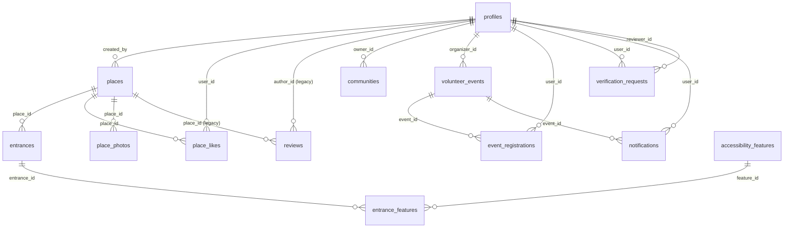

# Database Rangkul

Dokumen ini adalah **sumber kebenaran skema database** untuk tiga fitur Rangkul: informasi aksesibilitas tempat, direktori komunitas, dan volunteer inklusif.

Status: **Fitur 1 (feed postingan), direktori komunitas, dan modul Volunteer sudah diimplementasikan.** Tabel `profiles`, `places`, `place_likes`, `entrances`, `accessibility_features`, `entrance_features`, `place_photos`, `reviews`, `communities`, `verification_requests`, `volunteer_events`, `event_registrations`, dan `notifications` sudah ada di `prisma/schema.prisma` serta sudah dimigrasikan. Postingan baru dari `/tambah-info` wajib menyertakan rating pemosting 1–5, minimal satu foto, dan satu titik lokasi. Fasilitas yang dicentang disimpan di `places.facilities`. Moderasi AI dinonaktifkan sementara (`AI_MODERATION_ENABLED=false`), jadi postingan langsung `PUBLISHED`. Satu postingan mewakili satu lokasi; tidak ada pemilihan pintu masuk per postingan.

Tabel `reviews` masih ada di schema dan trigger agregat `rating_avg`/`review_count` masih berjalan, tetapi **tidak dipakai oleh alur UI saat ini**. Rating yang ditampilkan berasal dari `places.poster_rating`, yaitu penilaian pemosting. Tabel `reports` dan `moderation_logs` **belum dibuat** dan masih berupa rencana.

Modul Volunteer menambahkan `volunteer_events`, `event_registrations`, `notifications`, enum baru, trigger, dan RLS secara additive. Tabel bersama `profiles`, `communities`, dan `verification_requests` dipakai bersama dan tidak dibuat ulang oleh migration Volunteer. Semua migration tersedia di `prisma/migrations` dan sudah diterapkan ke database bersama.

- Ringkasan entitas dan aturan tingkat arsitektur: [`docs/architecture.md`](./architecture.md) §10.
- Kebutuhan produk: [`docs/product.md`](./product.md).
- Tipe UI: [`types/place.ts`](../types/place.ts) (dipetakan dari Prisma di `server/places/mappers.ts`).
- Kode implementasi: [`prisma/schema.prisma`](../prisma/schema.prisma), [`server/places/queries.ts`](../server/places/queries.ts), [`prisma/seed.ts`](../prisma/seed.ts).

---

## 1. Ruang Lingkup

| Fitur | Tabel utama | Status |
|---|---|---|
| Informasi & navigasi tempat (feed postingan) | `places`, `place_likes`, `entrances`, `accessibility_features`, `entrance_features`, `place_photos`, `reviews` | diimplementasikan (`reviews` legacy) |
| Direktori komunitas | `communities`, `verification_requests` | diimplementasikan |
| Volunteer inklusif | `volunteer_events`, `event_registrations` | diimplementasikan |
| Notifikasi in-app | `notifications` | diimplementasikan |
| Lintas fitur | `profiles` | diimplementasikan |
| Laporan & log moderasi | `reports`, `moderation_logs` | rencana, belum dimigrasikan |

Di luar dokumen ini: kebijakan moderasi AI dan detail retensi. Kode Prisma, migrasi SQL, seed, dan query backend **mengikuti** dokumen ini; jika implementasi berbeda, dokumen ini yang diperbarui lebih dulu.

---

## 2. Konvensi

### 2.1 Penamaan

| Lapisan | Aturan | Contoh |
|---|---|---|
| Tabel | `snake_case`, plural | `volunteer_events` |
| Kolom | `snake_case` | `created_at`, `rating_avg` |
| Primary key | selalu `id` | `id` |
| Foreign key | `<entitas>_id` | `place_id`, `author_id` |
| Model Prisma | PascalCase, dipetakan dengan `@@map` | `model VolunteerEvent { @@map("volunteer_events") }` |
| Enum Prisma | PascalCase, nilai `UPPER_SNAKE` | `EventStatus.PUBLISHED` |
| Index | `idx_<tabel>_<kolom>` | `idx_places_status_category` |
| Unique index | `uq_<tabel>_<kolom>` | `uq_reviews_place_author` |
| Foreign key constraint | `fk_<tabel>_<kolom>` | `fk_entrances_place_id` |

Nama identifier tetap bahasa Inggris. Label yang dilihat pengguna tetap bahasa Indonesia dan tidak disimpan sebagai nama kolom.

### 2.2 Tipe & default

| Kebutuhan | Tipe | Default |
|---|---|---|
| Primary key | `uuid` | `gen_random_uuid()` |
| Waktu | `timestamptz` (UTC) | `now()` untuk `created_at` |
| Uang | tidak ada di skema ini | — |
| Rating agregat | `numeric(3,2)` | `0` |
| Rating review | `smallint` | — |
| Koordinat | `numeric(9,6)` | — |
| Flag | `boolean` | `false` |
| Daftar pendek | `text[]` | `'{}'` |
| Struktur bebas | `jsonb` | `'{}'` |
| Urutan | `integer` | `0` |

Aturan tambahan:

- Semua waktu disimpan UTC. Konversi ke `Asia/Jakarta` hanya di lapisan tampilan.
- `updated_at` diisi trigger `set_updated_at()` pada setiap `UPDATE`.
- Soft delete memakai `archived_at timestamptz` untuk konten publik. Baris tidak dihapus fisik kecuali diminta kebijakan retensi.
- Jangan memakai auto-increment yang bisa ditebak untuk ID publik.
- `slug` unik dan stabil. Setelah publikasi, perubahan `slug` wajib disertai redirect.

### 2.3 Enum

Enum memakai tipe enum Postgres, bukan `text` bebas. Penambahan nilai baru dilakukan lewat migrasi `ALTER TYPE ... ADD VALUE` dan harus kompatibel ke belakang.

---

## 3. ERD



Catatan relasi:

- `communities` tidak memiliki relasi Prisma ke `volunteer_events`. `volunteer_events.community_id` masih kolom nullable tanpa FK; relasi ditunda sampai struktur komunitas disepakati.
- `reviews` adalah tabel legacy. Relasinya masih ada di schema dan trigger agregat masih berjalan, tetapi tidak ada alur UI yang membuat atau menampilkan ulasan.
- `notifications.event_id` bersifat opsional dan terhubung ke `volunteer_events`.
- `reports` dan `moderation_logs` belum ada di schema, sehingga tidak digambar di ERD.
- Tidak ada tabel keanggotaan komunitas. Pendaftaran anggota memakai `communities.join_url` ke grup eksternal.
- `event_registrations.user_id` wajib (bukan nullable). Pendaftaran volunteer selalu butuh login.

---

## 4. Enum

Nama tipe enum bersama di PostgreSQL memakai PascalCase: `UserRole`, `CommunityStatus`, `ContentStatus`, `FeatureValue`, `PlaceCategory`, `ReviewStatus`, `VerificationStatus`, `VerificationType`. Enum baru Volunteer juga PascalCase: `EventStatus`, `EventCategory`, `RegistrationStatus`, `NotificationType`. Model Prisma tidak memakai `@@map` untuk enum.

### 4.1 `UserRole`

| Nilai | Arti |
|---|---|
| `USER` | Pengguna umum |
| `ORGANIZER` | Penyelenggara kegiatan yang sudah terverifikasi |
| `ADMIN` | Moderator dan admin platform |

### 4.2 `PlaceCategory`

`WISATA`, `KULINER`, `TRANSPORTASI`, `IBADAH`, `KESEHATAN`, `FASILITAS_UMUM`, `LAINNYA`

Nilai aplikasi/URL dipetakan di `lib/constants/places.ts`: `wisata`, `kuliner`, `transportasi`, `ibadah`, `kesehatan`, `fasilitas-umum`, `lainnya`.

### 4.3 `ContentStatus`

Dipakai `places.status`.

`PENDING`, `PUBLISHED`, `REJECTED`, `ARCHIVED`

### 4.4 `ReviewStatus`

`PENDING`, `PUBLISHED`, `REJECTED`

### 4.5 `FeatureValue`

`AVAILABLE`, `NOT_AVAILABLE`, `UNKNOWN`

### 4.6 `CommunityStatus`

`PENDING`, `VERIFIED`, `REJECTED`, `SUSPENDED`

### 4.7 `EventStatus`

`DRAFT`, `PENDING`, `PUBLISHED`, `CLOSED`, `REJECTED`

### 4.8 `EventCategory`

`EVENT_SUPPORT`, `ACCESSIBILITY_AUDIT`, `SOCIAL_ACTIVITY`, `INCLUSIVE_PROGRAM`, `OTHER`

### 4.9 `RegistrationStatus`

`PENDING`, `CONFIRMED`, `CANCELLED`

### 4.10 `VerificationType` & `VerificationStatus`

| Enum | Nilai |
|---|---|
| `VerificationType` | `COMMUNITY`, `ORGANIZER` |
| `VerificationStatus` | `PENDING`, `APPROVED`, `REJECTED` |

### 4.11 `NotificationType`

Dipakai `notifications.type`.

`EVENT_UPDATED`, `EVENT_ARCHIVED`

### 4.12 Enum yang belum dimigrasikan

Enum untuk laporan dan log moderasi masih berupa rencana dan **belum ada di `prisma/schema.prisma`**:

| Enum | Nilai yang direncanakan |
|---|---|
| `report_target_type` | `PLACE`, `ENTRANCE`, `REVIEW`, `COMMUNITY`, `VOLUNTEER_EVENT` |
| `report_reason` | `INACCURATE`, `SPAM`, `OFFENSIVE`, `DUPLICATE`, `OTHER` |
| `report_status` | `OPEN`, `REVIEWING`, `RESOLVED`, `DISMISSED` |
| `moderation_decision` | `APPROVED`, `FLAGGED`, `REJECTED` |

---

## 5. Tabel

### 5.1 `profiles`

Profil aplikasi. `id` sama dengan UUID Supabase Auth, bukan auto-increment.

Struktur aktual database bersama (bukan dibuat ulang oleh Volunteer):

| Kolom | Tipe | Null | Default | Constraint |
|---|---|---|---|---|
| `id` | `uuid` | tidak | — | PK (FK `auth.users(id)` **belum** dibuat) |
| `email` | `text` | tidak | — | unik `profiles_email_key` + unik `lower(email)` |
| `name` | `text` | tidak | — | panjang 1–80 (`chk_profiles_name_length`) |
| `role` | `UserRole` | tidak | `'USER'` | — |
| `avatar_url` | `text` | ya | — | URL storage |
| `bio` | `text` | ya | — | maksimal 500 karakter (`chk_profiles_bio_length`) |
| `created_at` | `timestamptz` | tidak | `CURRENT_TIMESTAMP` | — |
| `updated_at` | `timestamptz` | tidak | — (diisi trigger) | trigger `trg_profiles_updated_at` |

Index: `profiles_email_key` (`email`), `uq_profiles_email_lower` (`lower(email)`), `idx_profiles_role`.

Catatan:
- Database bersama saat ini **tidak memiliki FK `profiles.id` → `auth.users(id)`**. Pasangan auth divalidasi di server/seed. Ini keputusan pemilik fitur bersama dan tidak diubah oleh Volunteer.
- Role disimpan di database, tidak pernah di cookie atau state client. Perubahan role hanya lewat admin/server.
- Trigger proteksi role pada tabel bersama **belum ada** di database saat ini. Volunteer tidak menambahkannya tanpa persetujuan; lihat rekomendasi keamanan terpisah.

Catatan implementasi Fitur 1: relasi ke `auth.users` dan RLS sengaja ditunda sampai fase auth. Saat ini `profiles.id` diisi UUID acak oleh seed, dan query publik tidak pernah membaca `profiles` secara langsung (hanya `name` lewat relasi `createdBy`/`author`).

### 5.2 `places`

| Kolom | Tipe | Null | Default | Constraint |
|---|---|---|---|---|
| `id` | `uuid` | tidak | `gen_random_uuid()` | PK |
| `slug` | `text` | tidak | — | unik, `^[a-z0-9]+(-[a-z0-9]+)*$` |
| `name` | `text` | tidak | — | panjang 2–120 |
| `category` | `PlaceCategory` | tidak | — | — |
| `description` | `text` | tidak | — | panjang 40–2000 (validasi server) |
| `address` | `text` | ya | — | panjang 5–300 |
| `city` | `text` | ya | — | — |
| `province` | `text` | ya | — | — |
| `latitude` | `numeric(9,6)` | tidak | — | `-90..90` |
| `longitude` | `numeric(9,6)` | tidak | — | `-180..180` |
| `status` | `ContentStatus` | tidak | `'PENDING'` | — |
| `created_by` | `uuid` | tidak | — | FK `profiles(id)` `ON DELETE RESTRICT` |
| `rating_avg` | `numeric(3,2)` | tidak | `0` | `0..5`, dihitung trigger dari `reviews` (legacy) |
| `review_count` | `integer` | tidak | `0` | `>= 0`, dihitung trigger dari `reviews` (legacy) |
| `poster_rating` | `smallint` | ya | — | `1..5` (`chk_places_poster_rating`), diisi pemosting |
| `facilities` | `text[]` | tidak | `'{}'` | subset key fasilitas (`chk_places_facilities`) |
| `moderation_note` | `text` | ya | — | alasan/ringkasan hasil moderasi AI |
| `moderated_at` | `timestamptz` | ya | — | waktu moderasi terakhir |
| `default_origin_label` | `text` | ya | — | legacy, tidak dipakai navigasi |
| `default_origin_latitude` | `numeric(9,6)` | ya | — | legacy, tidak dipakai navigasi |
| `default_origin_longitude` | `numeric(9,6)` | ya | — | legacy, tidak dipakai navigasi |
| `published_at` | `timestamptz` | ya | — | wajib terisi saat `PUBLISHED` |
| `archived_at` | `timestamptz` | ya | — | soft delete |
| `created_at` | `timestamptz` | tidak | `now()` | — |
| `updated_at` | `timestamptz` | tidak | `now()` | trigger |

Index:

- `uq_places_slug` (`slug`)
- `idx_places_status_category` (`status`, `category`)
- `idx_places_location` (`province`, `city`)
- `idx_places_name_trgm` GIN (`name gin_trgm_ops`) untuk pencarian
- `idx_places_coordinates` (`latitude`, `longitude`) untuk bounding box

Aturan: `rating_avg` dan `review_count` adalah cache agregat legacy dari tabel `reviews`. Jangan menulisnya dari server action; biarkan trigger §7 yang memperbarui. UI saat ini **tidak memakai** kedua kolom tersebut; rating yang ditampilkan berasal dari `poster_rating`.

Aturan `poster_rating` dan `facilities`:

- `poster_rating` wajib diisi saat membuat postingan (validasi Zod 1–5) dan dipakai untuk menampilkan rating pemosting.
- Badge **“Ramah Disabilitas”** muncul bila `poster_rating >= 4`.
- `facilities` berisi key fasilitas yang dicentang pemosting. Nilai yang diizinkan: `ramp`, `lift`, `accessible-toilet`, `guiding-block`, `accessible-parking`, `automatic-door`, `wide-entrance`.
- Mapping UI menggabungkan `facilities` dengan fasilitas `AVAILABLE` dari `entrance_features` legacy menjadi `availableFeatures`.

Aturan feed postingan:

- Satu baris `places` adalah satu **postingan** pengguna, bukan entitas tempat kanonik. Nama tempat tidak unik: pengguna berbeda boleh memposting nama yang sama, dan semuanya tampil saat dicari.
- `address`, `city`, dan `province` opsional karena form posting hanya mengumpulkan titik peta. Tampilan memakai fallback “Lokasi ditandai di peta”.
- Feed **selalu** diurutkan `jumlah place_likes DESC` lalu `created_at DESC`, baik saat ada pencarian maupun tidak. Pencarian dan filter kategori dilakukan di client setelah data diambil.
- Setiap postingan baru wajib punya minimal satu baris `place_photos` (lihat §5.7). Foto pertama (`sort_order` terkecil) dipakai sebagai sampul di timeline.
- Postingan baru **tidak** membuat baris `entrances`. Navigasi memakai koordinat `places.latitude/longitude` sebagai satu-satunya tujuan. Baris `entrances` lama tetap dibaca untuk agregat fasilitas dan langkah rute legacy, tetapi tidak lagi ditampilkan sebagai pilihan pintu.
- Moderasi AI dinonaktifkan sementara lewat `AI_MODERATION_ENABLED` (default `false`). Saat mati, postingan langsung `PUBLISHED` dengan `moderated_at = NULL` dan catatan “Moderasi AI dinonaktifkan sementara.”. Saat diaktifkan, hasil moderasi memetakan ke `SAFE` → `PUBLISHED`, `REVIEW` → `PENDING`, `BLOCK` → `REJECTED`; kegagalan moderasi selalu menjadi `PENDING`.

Aturan titik awal navigasi: halaman navigasi **hanya** memakai lokasi perangkat (`navigator.geolocation.watchPosition`). Tidak ada input manual, titik contoh, atau fallback ke `default_origin_*`. Kolom `default_origin_*` dipertahankan untuk kompatibilitas skema, tetapi tidak dibaca oleh aplikasi. Jika izin lokasi ditolak, UI menampilkan pesan dan tombol coba lagi tanpa menggambar rute.

### 5.3 `place_likes`

Tombol **“Paling membantu”**. Satu baris per pasangan postingan–pengguna, sehingga setiap pengguna hanya bisa menandai satu postingan sekali dan dapat membatalkannya.

| Kolom | Tipe | Null | Default | Constraint |
|---|---|---|---|---|
| `id` | `uuid` | tidak | `gen_random_uuid()` | PK |
| `place_id` | `uuid` | tidak | — | FK `places(id)` `ON DELETE CASCADE` |
| `user_id` | `uuid` | tidak | — | FK `profiles(id)` `ON DELETE CASCADE` |
| `created_at` | `timestamptz` | tidak | `now()` | — |

Index:

- `place_likes_place_id_user_id_key` unik (`place_id`, `user_id`)
- `place_likes_place_id_idx` (`place_id`)

Aturan: jumlah “Paling membantu” dihitung dari `COUNT(place_likes)` lewat relasi Prisma `_count`, bukan kolom denormalisasi. Server action `togglePlaceLikeAction` memvalidasi login dan hanya menerima postingan `PUBLISHED`.

### 5.4 `entrances`

Satu baris per pintu masuk pada data **legacy**. Ini pembeda awal produk: kondisi aksesibilitas dinilai per pintu, bukan per bangunan. Sejak revisi feed postingan, pengguna tidak lagi memilih atau membuat pintu: satu postingan = satu lokasi, dan navigasi memakai koordinat `places`. Baris `entrances` dipertahankan agar agregat fasilitas (`entrance_features`) tetap kompatibel, tetapi tidak lagi menjadi bagian alur posting baru. Seed tempat contoh sudah dihapus.

| Kolom | Tipe | Null | Default | Constraint |
|---|---|---|---|---|
| `id` | `uuid` | tidak | `gen_random_uuid()` | PK |
| `place_id` | `uuid` | tidak | — | FK `places(id)` `ON DELETE CASCADE` |
| `label` | `text` | tidak | — | panjang 2–80 |
| `notes` | `text` | ya | — | maksimal 1000 karakter |
| `latitude` | `numeric(9,6)` | ya | — | `-90..90` |
| `longitude` | `numeric(9,6)` | ya | — | `-180..180` |
| `is_main` | `boolean` | tidak | `false` | satu per place (partial unique) |
| `photo_url` | `text` | ya | — | — |
| `route_distance_m` | `integer` | ya | — | `> 0` |
| `route_duration_min` | `integer` | ya | — | `> 0` |
| `route_condition` | `text` | ya | — | maksimal 500 karakter |
| `route_steps` | `text[]` | tidak | `'{}'` | maksimal 10 langkah |
| `created_at` | `timestamptz` | tidak | `now()` | — |
| `updated_at` | `timestamptz` | tidak | `now()` | trigger |

Index:

- `idx_entrances_place_id` (`place_id`)
- `uq_entrances_one_main` unik parsial `(place_id) WHERE is_main`
- `idx_entrances_coordinates` (`latitude`, `longitude`)

Aturan: data `entrances` bersifat legacy. Postingan baru tidak membuat baris ini, dan seed tempat contoh sudah dihapus. Jika `is_main` dipindah, trigger/server action harus memastikan hanya satu yang aktif. Halaman detail dan navigasi tidak menampilkan pemilih pintu.

### 5.5 `accessibility_features`

Master fasilitas. Tabel sistem yang di-seed, bukan dibuat pengguna.

| Kolom | Tipe | Null | Default | Constraint |
|---|---|---|---|---|
| `id` | `uuid` | tidak | `gen_random_uuid()` | PK |
| `key` | `text` | tidak | — | unik, `^[a-z0-9]+(-[a-z0-9]+)*$` |
| `label` | `text` | tidak | — | — |
| `short_label` | `text` | tidak | — | — |
| `category` | `text` | tidak | — | `entrance`, `building`, `service` |
| `icon` | `text` | tidak | — | nama ikon di `components/ui/icons.tsx` |
| `description` | `text` | tidak | — | — |
| `sort_order` | `integer` | tidak | `0` | — |
| `is_active` | `boolean` | tidak | `true` | — |
| `created_at` | `timestamptz` | tidak | `now()` | — |

Index: `uq_accessibility_features_key` (`key`), `idx_accessibility_features_active` (`is_active`, `sort_order`).

Seed awal didefinisikan di `prisma/seed-data.ts` (`SEED_FEATURES`) dan disinkronkan oleh `prisma/seed.ts` dengan upsert berdasarkan `key`: `ramp`, `lift`, `accessible-toilet`, `guiding-block`, `accessible-parking`, `automatic-door`, `wide-entrance`. Konstanta UI untuk label dan ikon ada di `lib/constants/places.ts`; jangan menduplikasi daftar ini di komponen.

### 5.6 `entrance_features`

Sumber fasilitas **legacy** per pintu. Satu baris per pasangan pintu–fasilitas. Sejak revisi feed, daftar fasilitas utama disimpan di `places.facilities` dan digabung dengan nilai `AVAILABLE` di tabel ini saat mapping.

| Kolom | Tipe | Null | Default | Constraint |
|---|---|---|---|---|
| `id` | `uuid` | tidak | `gen_random_uuid()` | PK |
| `entrance_id` | `uuid` | tidak | — | FK `entrances(id)` `ON DELETE CASCADE` |
| `feature_id` | `uuid` | tidak | — | FK `accessibility_features(id)` `ON DELETE RESTRICT` |
| `value` | `FeatureValue` | tidak | `'UNKNOWN'` | — |
| `notes` | `text` | ya | — | maksimal 300 karakter |
| `updated_by` | `uuid` | ya | — | FK `profiles(id)` `ON DELETE SET NULL` |
| `created_at` | `timestamptz` | tidak | `now()` | — |
| `updated_at` | `timestamptz` | tidak | `now()` | trigger |

Index:

- `uq_entrance_features_pair` (`entrance_id`, `feature_id`)
- `idx_entrance_features_filter` (`feature_id`, `value`)

Aturan: jangan menambahkan alur baru yang menulis `places.facilities` duplikat tanpa sinkronisasi. Saat ini `places.facilities` adalah sumber utama untuk postingan baru, sedangkan `entrance_features` dipertahankan untuk data legacy dan digabung saat mapping. `UNKNOWN` berarti belum dikonfirmasi, bukan "tidak ada".

### 5.7 `place_photos`

Foto lampiran postingan. Setiap postingan baru wajib punya **minimal satu** baris; maksimal 4 foto per postingan (validasi server), masing-masing maksimal 5 MB dengan tipe `image/jpeg`, `image/png`, atau `image/webp`.

| Kolom | Tipe | Null | Default | Constraint |
|---|---|---|---|---|
| `id` | `uuid` | tidak | `gen_random_uuid()` | PK |
| `place_id` | `uuid` | tidak | — | FK `places(id)` `ON DELETE CASCADE` |
| `url` | `text` | tidak | — | URL publik bucket `place-photos` |
| `alt` | `text` | tidak | `''` | teks alternatif foto |
| `sort_order` | `integer` | tidak | `0` | `>= 0`, urutan tampil; indeks 0 = sampul |
| `created_by` | `uuid` | ya | — | FK `profiles(id)` `ON DELETE SET NULL` |
| `created_at` | `timestamptz` | tidak | `now()` | — |

Index: `idx_place_photos_place_order` (`place_id`, `sort_order`).

Aturan tampilan:

- Timeline `/jelajahi` hanya menampilkan foto pertama (`sort_order` terkecil) sebagai sampul, dengan penanda jumlah foto bila lebih dari satu.
- Halaman detail menampilkan carousel bila ada lebih dari satu foto.
- Foto diunggah ke bucket `place-photos` memakai sesi pengguna, lalu baris `place_photos` dibuat setelah unggahan berhasil. Bila penyimpanan `places` gagal, foto yang sudah terunggah dihapus kembali (best-effort).

Bucket `place-photos`:

| Properti | Nilai |
|---|---|
| public | `true` (baca publik untuk sampul & carousel) |
| file size limit | 5 MB |
| allowed MIME | `image/jpeg`, `image/png`, `image/webp` |
| path | `<user_id>/<uuid>.<ext>` |

Kebijakan RLS pada `storage.objects` (dibuat oleh migrasi `20261103100000_place_photos_storage`):

| Policy | Operasi | Aturan |
|---|---|---|
| `place_photos_select_own` | `SELECT` | `bucket_id = 'place-photos' and owner = auth.uid()` (dibutuhkan agar hapus/overwrite berhasil) |
| `place_photos_insert_own` | `INSERT` | `bucket_id = 'place-photos' and owner = auth.uid()` |
| `place_photos_delete_own` | `DELETE` | `bucket_id = 'place-photos' and owner = auth.uid()` |

Baca publik dilakukan lewat endpoint `storage/v1/object/public/...` sehingga tidak memerlukan policy `SELECT` untuk anon.

### 5.8 `reviews` (legacy)

> Tabel ini masih ada di schema dan trigger agregatnya masih berjalan, tetapi **tidak dipakai oleh UI saat ini**. Tidak ada form, halaman, atau server action yang membuat ulasan. Rating tempat berasal dari `places.poster_rating`. Jangan membangun fitur baru di atas tabel ini tanpa keputusan produk terpisah.

| Kolom | Tipe | Null | Default | Constraint |
|---|---|---|---|---|
| `id` | `uuid` | tidak | `gen_random_uuid()` | PK |
| `place_id` | `uuid` | tidak | — | FK `places(id)` `ON DELETE CASCADE` |
| `author_id` | `uuid` | tidak | — | FK `profiles(id)` `ON DELETE CASCADE` |
| `rating` | `smallint` | tidak | — | `1..5` |
| `body` | `text` | tidak | — | panjang 10–2000 |
| `accessibility_note` | `text` | ya | — | maksimal 500 karakter |
| `status` | `ReviewStatus` | tidak | `'PENDING'` | — |
| `published_at` | `timestamptz` | ya | — | — |
| `created_at` | `timestamptz` | tidak | `now()` | — |
| `updated_at` | `timestamptz` | tidak | `now()` | trigger |
| `archived_at` | `timestamptz` | ya | — | soft delete |

Index:

- `uq_reviews_place_author` unik parsial `(place_id, author_id) WHERE archived_at IS NULL` — satu review aktif per pengguna per tempat.
- `idx_reviews_place_published` (`place_id`, `status`, `published_at DESC`)
- `idx_reviews_author` (`author_id`)

Aturan: review yang di-`ARCHIVED`/`REJECTED` tidak dihitung ke `rating_avg`. Edit review tidak membuat baris baru; update baris yang sama dan kembalikan status ke `PENDING` bila isi berubah.

### 5.9 `communities`

| Kolom | Tipe | Null | Default | Constraint |
|---|---|---|---|---|
| `id` | `uuid` | tidak | `gen_random_uuid()` | PK |
| `slug` | `text` | tidak | — | unik |
| `name` | `text` | tidak | — | panjang 2–120 |
| `description` | `text` | tidak | — | panjang 20–3000 |
| `province` | `text` | tidak | — | — |
| `city` | `text` | tidak | — | — |
| `focus` | `text[]` | tidak | `'{}'` | maksimal 8 item |
| `contact` | `text` | tidak | — | email atau nomor telepon |
| `socials` | `jsonb` | tidak | `'{}'` | kunci: `instagram`, `facebook`, `website` |
| `join_url` | `text` | tidak | — | URL grup/tautan pendaftaran eksternal |
| `logo_url` | `text` | ya | — | bucket `community-logos` |
| `status` | `CommunityStatus` | tidak | `'PENDING'` | — |
| `owner_id` | `uuid` | tidak | — | FK `profiles(id)` `ON DELETE RESTRICT` |
| `verified_at` | `timestamptz` | ya | — | — |
| `verified_by` | `uuid` | ya | — | FK `profiles(id)` `ON DELETE SET NULL` |
| `archived_at` | `timestamptz` | ya | — | — |
| `created_at` | `timestamptz` | tidak | `now()` | — |
| `updated_at` | `timestamptz` | tidak | `now()` | trigger |

Index:

- `uq_communities_slug` (`slug`)
- `idx_communities_status` (`status`)
- `idx_communities_location` (`province`, `city`)
- `idx_communities_focus` GIN (`focus`)
- `idx_communities_name_trgm` GIN (`name gin_trgm_ops`)

Aturan: `status = 'VERIFIED'` wajib punya `verified_at` dan `verified_by`. Hanya komunitas `VERIFIED` yang tampil di direktori publik.

### 5.10 `volunteer_events`

| Kolom | Tipe | Null | Default | Constraint |
|---|---|---|---|---|
| `id` | `uuid` | tidak | `gen_random_uuid()` | PK |
| `slug` | `text` | tidak | — | unik |
| `organizer_id` | `uuid` | tidak | — | FK `profiles(id)` `ON DELETE RESTRICT`, role `ORGANIZER`/`ADMIN` |
| `community_id` | `uuid` | ya | — | belum ada FK; menunggu struktur `communities` disepakati |
| `title` | `text` | tidak | — | panjang 5–150 |
| `description` | `text` | tidak | — | panjang 20–5000 |
| `category` | `EventCategory` | tidak | — | — |
| `location_name` | `text` | tidak | — | — |
| `address` | `text` | tidak | — | — |
| `city` | `text` | tidak | — | tidak boleh kosong |
| `province` | `text` | tidak | — | tidak boleh kosong |
| `latitude` | `numeric(9,6)` | ya | — | `-90..90` |
| `longitude` | `numeric(9,6)` | ya | — | `-180..180` |
| `starts_at` | `timestamptz` | tidak | — | — |
| `ends_at` | `timestamptz` | tidak | — | `> starts_at` |
| `requirements` | `text` | ya | — | maksimal 2000 karakter; satu persyaratan per baris (`\n`) |
| `accessibility_notes` | `text` | ya | — | maksimal 2000 karakter |
| `slots` | `integer` | tidak | — | `> 0` |
| `registered_count` | `integer` | tidak | `0` | `0..slots`, dihitung trigger |
| `status` | `EventStatus` | tidak | `'DRAFT'` | — |
| `moderation_note` | `text` | ya | — | catatan penolakan admin, maksimal 500 karakter |
| `cover_url` | `text` | ya | — | path/URL bucket `event-covers` |
| `cover_alt` | `text` | ya | — | wajib bila `cover_url` terisi |
| `published_at` | `timestamptz` | ya | — | wajib saat `PUBLISHED` |
| `archived_at` | `timestamptz` | ya | — | — |
| `created_at` | `timestamptz` | tidak | `now()` | — |
| `updated_at` | `timestamptz` | tidak | `now()` | trigger |

Index:

- `uq_volunteer_events_slug` (`slug`)
- `idx_volunteer_events_status_start` (`status`, `starts_at`)
- `idx_volunteer_events_organizer` (`organizer_id`)
- `idx_volunteer_events_community` (`community_id`)
- `idx_volunteer_events_location` (`province`, `city`)
- `idx_volunteer_events_title_trgm` GIN (`title gin_trgm_ops`)

Aturan:

- `registered_count` dihitung dari `event_registrations` berstatus `CONFIRMED`. Jangan menulis manual. Event `PUBLISHED` yang `ends_at` sudah lewat boleh ditandai `CLOSED` oleh job terjadwal.
- Kuota penerimaan pendaftaran baru dihitung dari pendaftaran `PENDING` + `CONFIRMED`. Ini berbeda dari angka `registered_count` yang ditampilkan (hanya `CONFIRMED`).
- `community_id` sengaja nullable dan **belum memiliki relasi/FK** di Prisma maupun SQL. FK ditambahkan lewat migrasi baru setelah tabel `communities` disepakati.
- `requirements` disimpan sebagai satu kolom `text`. UI memecahnya per baris baru; jangan mengubahnya menjadi array di database.
- `cover_url` menunjuk ke bucket `event-covers`. `cover_alt` wajib diisi agar gambar informatif tetap aksesibel.
- `moderation_note` diisi admin saat menolak kegiatan dan ditampilkan ke penyelenggara di dashboard.

### 5.11 `event_registrations`

| Kolom | Tipe | Null | Default | Constraint |
|---|---|---|---|---|
| `id` | `uuid` | tidak | `gen_random_uuid()` | PK |
| `event_id` | `uuid` | tidak | — | FK `volunteer_events(id)` `ON DELETE CASCADE` |
| `user_id` | `uuid` | tidak | — | FK `profiles(id)` `ON DELETE CASCADE` |
| `name` | `text` | tidak | — | panjang 1–80 |
| `email` | `text` | tidak | — | format email |
| `phone` | `text` | tidak | — | `^\+?[0-9 -]{8,20}$` |
| `accessibility_needs` | `text` | ya | — | maksimal 500 karakter |
| `status` | `RegistrationStatus` | tidak | `'PENDING'` | — |
| `cancelled_at` | `timestamptz` | ya | — | wajib saat `CANCELLED` |
| `created_at` | `timestamptz` | tidak | `now()` | — |
| `updated_at` | `timestamptz` | tidak | `now()` | trigger |

Index:

- `uq_event_registrations_event_user` (`event_id`, `user_id`)
- `idx_event_registrations_event_status` (`event_id`, `status`)
- `idx_event_registrations_user` (`user_id`)

Aturan:

- `user_id` wajib. Tidak ada pendaftaran anonim.
- Satu pengguna satu pendaftaran per event. Batal lalu daftar lagi memakai baris yang sama.
- Pendaftaran baru berstatus `PENDING`. Hanya penyelenggara/admin yang dapat mengubahnya menjadi `CONFIRMED`; pengguna dapat membatalkan (`CANCELLED`).
- Kuota saat menerima pendaftaran dihitung dari `PENDING` + `CONFIRMED` dan divalidasi ulang dengan row lock di dalam transaksi. Konfirmasi dibatasi `slots` dan hanya untuk baris `PENDING`.
- Data `name`, `email`, `phone`, `accessibility_needs` adalah PII. Hanya organizer event terkait dan admin yang boleh membacanya.
- Ekspor Excel dilakukan di server dan hanya untuk organizer/admin.

### 5.12 `verification_requests`

| Kolom | Tipe | Null | Default | Constraint |
|---|---|---|---|---|
| `id` | `uuid` | tidak | `gen_random_uuid()` | PK |
| `user_id` | `uuid` | tidak | — | FK `profiles(id)` `ON DELETE CASCADE` |
| `type` | `VerificationType` | tidak | — | — |
| `payload` | `jsonb` | tidak | `'{}'` | tanpa dokumen sensitif |
| `document_url` | `text` | ya | — | path bucket privat `verification-docs` |
| `status` | `VerificationStatus` | tidak | `'PENDING'` | — |
| `reviewer_id` | `uuid` | ya | — | FK `profiles(id)` `ON DELETE SET NULL` |
| `review_note` | `text` | ya | — | maksimal 1000 karakter (`chk_verification_review_note_length`) |
| `submitted_at` | `timestamptz` | tidak | `now()` | — |
| `reviewed_at` | `timestamptz` | ya | — | — |
| `created_at` | `timestamptz` | tidak | `now()` | — |

Index:

- `uq_verification_requests_pending` unik parsial `(user_id, type) WHERE status = 'PENDING'`
- `idx_verification_requests_status` (`status`, `submitted_at`)

Aturan: `payload` berisi data teks (nama organisasi, kontak, tautan). KTP/selfie **tidak** disimpan di `payload`; simpan di bucket privat dan catat path di `document_url`. Hapus dokumen setelah verifikasi selesai atau setelah masa retensi.

### 5.13 `notifications`

Notifikasi in-app untuk pengguna. Hanya dibuat oleh server (Prisma) dan dibaca/ditandai oleh pemiliknya.

| Kolom | Tipe | Null | Default | Constraint |
|---|---|---|---|---|
| `id` | `uuid` | tidak | `gen_random_uuid()` | PK |
| `user_id` | `uuid` | tidak | — | FK `profiles(id)` `ON DELETE CASCADE` |
| `type` | `NotificationType` | tidak | — | `EVENT_UPDATED`, `EVENT_ARCHIVED` |
| `title` | `varchar(160)` | tidak | — | — |
| `body` | `varchar(500)` | tidak | — | — |
| `href` | `varchar(300)` | ya | — | tujuan setelah diklik |
| `event_id` | `uuid` | ya | — | FK `volunteer_events(id)` `ON DELETE CASCADE` |
| `read_at` | `timestamptz` | ya | — | null = belum dibaca |
| `created_at` | `timestamptz` | tidak | `now()` | — |

Index: `idx_notifications_user_read_created` (`user_id`, `read_at`, `created_at`). RLS: `notifications_select_own` dan `notifications_update_own` membatasi ke `user_id = auth.uid()`.

Aturan: notifikasi `EVENT_UPDATED` dikirim ke peserta aktif saat detail kegiatan yang sudah terbit berubah; `EVENT_ARCHIVED` dikirim saat kegiatan diarsipkan. Pengguna hanya dapat menandai notifikasinya sendiri sebagai dibaca.

### 5.14 Tabel yang belum dimigrasikan

`reports` dan `moderation_logs` masih berupa **rencana** dan belum ada di `prisma/schema.prisma` maupun migration. Struktur yang dituju (belum final):

- `reports`: `reporter_id`, `target_type`, `target_id`, `reason`, `details`, `status`, `resolved_by`, `resolution_note`, `resolved_at`.
- `moderation_logs`: `content_type`, `content_id`, `provider`, `score`, `labels`, `decision`, `raw_response`, `reviewed_by`, `created_at`.

Jangan menganggap kedua tabel ini tersedia di database sampai migration-nya dibuat.

---

## 6. Siklus Status

### 6.1 `places.status`

```text
PENDING ──approve──> PUBLISHED ──arsip──> ARCHIVED
   │                    │
   │                    └──takedown──> ARCHIVED
   └──reject──> REJECTED ──perbaiki──> PENDING
```

- `PENDING`: kontribusi baru atau hasil edit yang perlu ditinjau.
- `PUBLISHED`: tampil publik, `published_at` terisi.
- `REJECTED`: tidak tampil; kontributor boleh memperbaiki dan mengirim ulang.
- `ARCHIVED`: soft delete/takedown; tidak tampil dan tidak masuk pencarian.

### 6.2 `reviews.status` (legacy)

`PENDING` → `PUBLISHED` | `REJECTED`. Review `PUBLISHED` yang diedit kembali ke `PENDING`. Siklus ini tidak dipakai UI saat ini.

### 6.3 `communities.status`

`PENDING` → `VERIFIED` | `REJECTED`. `VERIFIED` → `SUSPENDED` bila melanggar. `SUSPENDED` → `VERIFIED` setelah banding diterima.

### 6.4 `volunteer_events.status`

```text
DRAFT ──ajukan──> PENDING ──approve──> PUBLISHED ──tutup──> CLOSED
  │                  │                     │
  │                  └──reject──> REJECTED  └──takedown──> REJECTED
  └──ajukan───────> PENDING ──approve──> PUBLISHED
```

- `DRAFT` hanya terlihat oleh organizer. `REJECTED` dapat diperbaiki lalu diajukan kembali.
- `saveEventAction` hanya mengubah status dari `DRAFT`/`REJECTED`; status lain dipertahankan.
- `submitEventAction` mengubah `DRAFT`/`REJECTED` → `PENDING`.
- `adminModerateEventAction` mengubah `PENDING` → `PUBLISHED` (mengisi `published_at`) atau `PENDING`/`PUBLISHED` → `REJECTED` dengan catatan.
- `closeEventAction` mengubah `PUBLISHED` → `CLOSED`.
- `PUBLISHED` wajib punya `published_at` dan `slots > 0`.

### 6.5 `event_registrations.status`

`PENDING` → `CONFIRMED` | `CANCELLED`. `CONFIRMED` → `CANCELLED` bila peserta membatalkan. Baris tidak dihapus agar riwayat tetap ada.

### 6.6 `verification_requests.status`

`PENDING` → `APPROVED` | `REJECTED`. Satu request `PENDING` per `(user_id, type)`. Setelah `APPROVED`, `profiles.role` naik menjadi `ORGANIZER` (atau komunitas ditandai `VERIFIED`).

### 6.7 `reports.status` (rencana)

Belum diimplementasikan. Rencana: `OPEN` → `REVIEWING` → `RESOLVED` | `DISMISSED`. `RESOLVED` wajib punya `resolved_by` dan `resolved_at`.

---

## 7. Agregat & Trigger

Agregat tidak dihitung saat request halaman. Nilainya dipelihara di database.

| Agregat | Sumber | Pemicu |
|---|---|---|
| `places.rating_avg`, `places.review_count` (legacy) | `reviews` berstatus `PUBLISHED` | insert/update/delete pada `reviews` |
| `volunteer_events.registered_count` | `event_registrations` berstatus `CONFIRMED` | insert/update/delete pada `event_registrations` |
| `updated_at` | baris mana pun | trigger `set_updated_at()` |

Fungsi bersama `set_updated_at()` sudah ada dan dipakai ulang oleh trigger Volunteer. Fungsi `refresh_event_registration_count()` dijalankan `SECURITY DEFINER` dengan `search_path = public, pg_temp` dan hanya mengubah `registered_count`.

> Catatan: trigger rating tetap ada karena tabel `reviews` dipertahankan, tetapi UI tidak membaca `rating_avg`/`review_count`. Rating tempat memakai `places.poster_rating` yang ditulis sekali saat posting.

```sql
create or replace function refresh_place_rating(target_place_id uuid)
returns void language plpgsql as $$
begin
  update places p
  set rating_avg = coalesce((
        select round(avg(r.rating)::numeric, 2)
        from reviews r
        where r.place_id = target_place_id
          and r.status = 'PUBLISHED'
          and r.archived_at is null
      ), 0),
      review_count = (
        select count(*)
        from reviews r
        where r.place_id = target_place_id
          and r.status = 'PUBLISHED'
          and r.archived_at is null
      )
  where p.id = target_place_id;
end;
$$;
```

```sql
create or replace function refresh_event_registration_count(target_event_id uuid)
returns void language plpgsql as $$
begin
  update volunteer_events e
  set registered_count = (
    select count(*)
    from event_registrations r
    where r.event_id = target_event_id
      and r.status = 'CONFIRMED'
  )
  where e.id = target_event_id;
end;
$$;
```

Aturan implementasi:

- Trigger memanggil fungsi di atas; jangan menduplikasi logika hitung di server action.
- Backfill awal dijalankan sekali setelah migrasi.
- Nilai agregat boleh dibaca langsung untuk tampilan daftar. Untuk keputusan yang butuh akurasi mutlak (misalnya validasi kuota), hitung ulang di dalam transaksi.
- Penulisan manual `registered_count` oleh non-admin hanya diterima bila nilainya sama dengan hasil hitung `CONFIRMED` **dan** tidak ada kolom lain yang berubah. Tidak ada flag sesi yang dapat dipalsukan client.

---

## 8. Auth, RLS, dan Privasi

### 8.1 Otorisasi

Prisma terhubung langsung ke Postgres sehingga **RLS tidak otomatis berlaku** untuk query Prisma (lihat `docs/architecture.md` §9.3). Karena itu:

- Semua otorisasi wajib dicek di server action/route handler sebelum query.
- Role diambil dari `profiles.role`, bukan dari cookie atau input client.
- Supabase JS di browser hanya untuk auth dan upload, bukan query tabel.
- Service role key hanya di server.

### 8.2 RLS (untuk akses via Supabase client)

RLS tetap diaktifkan sebagai lapisan pertahanan kedua.

| Tabel | Anon | Authenticated | Admin |
|---|---|---|---|
| `places` | baca `PUBLISHED` | baca `PUBLISHED` + milik sendiri | semua |
| `entrances`, `place_photos`, `entrance_features` | baca bila place `PUBLISHED` | sama | semua |
| `accessibility_features` | baca `is_active` | baca | semua |
| `reviews` (legacy) | baca `PUBLISHED` | baca `PUBLISHED` + milik sendiri | semua |
| `profiles` | tidak | baca semua (policy bersama saat ini), ubah milik sendiri | semua |
| `communities` | baca `VERIFIED` | baca `VERIFIED` + milik sendiri | semua |
| `volunteer_events` | baca `PUBLISHED` | baca `PUBLISHED` + milik sendiri | semua |
| `event_registrations` | tidak | milik sendiri, atau pendaftar event miliknya | semua |
| `verification_requests` | tidak | milik sendiri, hanya pengajuan `PENDING` | semua; review/ubah |
| `notifications` | tidak | milik sendiri; select/update | semua |
| `reports`, `moderation_logs` | — | — | belum ada tabelnya |

Aturan yang dituju: kolom `profiles.role` tidak boleh bisa diubah oleh pemilik profil; perubahan role hanya lewat server dengan service role setelah verifikasi.

**Status aktual database bersama:** policy `profiles_update_own` saat ini hanya membatasi `id = auth.uid()` dan belum ada trigger yang melindungi `role`. Policy `profiles_insert_own` juga belum membatasi `role = 'USER'`. Policy `communities_update_own` belum mencegah owner mengubah status verifikasi sendiri. Selain itu `profiles_select_authenticated USING (true)` membuat seluruh pengguna authenticated dapat membaca `email` semua profil.

Temuan ini **tidak diperbaiki oleh migration Volunteer** karena menyentuh policy/trigger tabel bersama. Perbaikannya membutuhkan persetujuan pemilik fitur Places/Communities dan migration hardening terpisah. Sementara itu, semua otorisasi Volunteer tetap wajib dicek di server dari `profiles.role`.

### 8.3 Privasi & retensi

| Data | Perlakuan |
|---|---|
| KTP/selfie verifikasi | bucket privat `verification-docs`, signed URL jangka pendek, hanya admin |
| `event_registrations` (nama, email, telepon, kebutuhan aksesibilitas) | hanya organizer event + admin; tidak pernah di API publik |
| `reports.reporter_id` (rencana) | nanti tidak ditampilkan ke publik |
| `moderation_logs.raw_response` (rencana) | redaksi PII sebelum disimpan |
| Akun dihapus | `profiles` cascade; konten publik dianonimkan atau di-`ARCHIVED`, bukan dihapus fisik |

Bucket storage:

| Bucket | Isi | Akses |
|---|---|---|
| `place-photos` | foto postingan Jelajahi (sampul + carousel) | public read, authenticated insert/delete milik sendiri (RLS `owner = auth.uid()`) |
| `community-logos` | logo komunitas | public read, authenticated write |
| `event-covers` | cover kegiatan | public read, authenticated write |
| `verification-docs` | dokumen verifikasi | **private**, signed URL, admin only |

---

## 9. Index & Pencarian

Ekstensi yang dibutuhkan:

```sql
create extension if not exists pg_trgm;
```

| Kebutuhan | Index |
|---|---|
| Cari nama tempat | GIN `places.name gin_trgm_ops` |
| Cari nama komunitas | GIN `communities.name gin_trgm_ops` |
| Cari judul kegiatan | GIN `volunteer_events.title gin_trgm_ops` |
| Filter kategori + status | btree `places(status, category)` |
| Filter fasilitas legacy | btree `entrance_features(feature_id, value)` |
| Filter fasilitas postingan | `places.facilities` (belum ada index khusus; GIN opsional bila volume naik) |
| Wilayah | btree `(province, city)` |
| Event mendatang | btree `volunteer_events(status, starts_at)` |

Aturan:

- Pencarian teks memakai `ILIKE '%kata%'` dengan index trigram sampai volume data menuntut full-text search.
- Query feed Jelajahi mengambil seluruh postingan `PUBLISHED`, lalu pencarian/filter kategori dilakukan di client. Index trigram tetap berguna untuk query lain dan pengembangan berikutnya.
- Untuk MVP, "terdekat" memakai bounding box pada `(latitude, longitude)` lalu diurutkan dengan jarak kuadrat di query. PostGIS belum dipakai.
- Jangan menambah index spekulatif. Setiap index harus punya query yang jelas.

Contoh filter fasilitas postingan baru (semua key diminta harus ada):

```sql
select p.*
from places p
where p.status = 'PUBLISHED'
  and p.archived_at is null
  and p.facilities @> $1::text[];
```

Contoh filter fasilitas legacy per pintu (semua fasilitas diminta harus `AVAILABLE`):

```sql
select p.*
from places p
where p.status = 'PUBLISHED'
  and p.archived_at is null
  and (
    select count(distinct ef.feature_id)
    from entrances e
    join entrance_features ef on ef.entrance_id = e.id
    where e.place_id = p.id
      and ef.feature_id = any($1::uuid[])
      and ef.value = 'AVAILABLE'
  ) = cardinality($1::uuid[]);
```

---

## 10. Migrasi & Seed

### 10.1 Urutan migrasi

Status per 31 Oktober 2026: **semua migration di repo sudah diterapkan** ke database bersama.

1. ✅ Ekstensi (`pg_trgm`) dan enum.
2. ✅ `profiles` (tanpa FK ke `auth.users`; lihat §5.1).
3. ✅ `accessibility_features`.
4. ✅ `places` → `entrances` → `entrance_features` → `place_photos` → `reviews`.
5. ✅ `communities` → `verification_requests`.
6. ✅ `place_likes` dan kolom moderasi postingan.
7. ✅ Modul Volunteer: enum, `volunteer_events`, `event_registrations`, trigger, RLS.
8. ✅ Storage: `place-photos`, `community-logos`, `event-covers`, `verification-docs`.
9. ✅ `notifications`, `NotificationType`, `volunteer_events.moderation_note`.
10. ✅ `places.poster_rating`, `places.facilities`, kategori `FASILITAS_UMUM` dan `LAINNYA`.
11. ⬜ `reports`, `moderation_logs` (belum dibuat).

Migrasi yang tersedia di repo (12 file):

| Migrasi | Isi |
|---|---|
| `20261031083304_init_feature1` | enum, `profiles`, `places`, `entrances`, `entrance_features`, `place_photos`, `reviews`, fungsi & trigger agregat, index trigram |
| `20261101120000_init_communities` | `communities`, `verification_requests`, bucket logo komunitas |
| `20261101121000_create_volunteer_enums` | `pg_trgm` (jika belum ada), `EventStatus`, `EventCategory`, `RegistrationStatus` |
| `20261101121100_create_volunteer_events` | tabel, check constraint, index, trigram, FK ke `profiles` |
| `20261101121200_create_event_registrations` | pendaftaran, unique `(event_id, user_id)` |
| `20261101121300_add_volunteer_triggers` | `updated_at` Volunteer, agregat `registered_count`, proteksi kegiatan/pendaftaran |
| `20261101121400_enable_volunteer_rls` | RLS dan grant khusus tabel Volunteer |
| `20261102120000_add_place_likes_and_post_moderation` | `place_likes`, kolom moderasi postingan |
| `20261103100000_place_photos_storage` | bucket `place-photos` + policy RLS (idempoten) |
| `20261104100000_community_and_volunteer_storage` | bucket `community-logos`, `event-covers`, `verification-docs` + policy |
| `20261104110000_add_notifications_and_event_moderation` | `notifications`, `NotificationType`, `volunteer_events.moderation_note` |
| `20261105100000_place_categories_and_poster_data` | kategori baru, `places.poster_rating`, `places.facilities`, check constraint |

Migrasi Fitur 1 memuat objek yang tidak bisa diekspresikan di `schema.prisma`: index trigram, partial unique index, check constraint, `set_updated_at()`, dan `reviews_refresh_place_rating()`.

#### Catatan migration Volunteer

Migration Volunteer bersifat **additive** dan sudah diterapkan. Migration ini:

- Tidak membuat ulang `profiles`, `communities`, atau `verification_requests`.
- Tidak membuat enum bersama `UserRole`, `VerificationType`, `VerificationStatus`.
- Tidak mengubah policy/grant tabel bersama.
- Tidak menambah trigger pada `profiles`.
- Tidak menambahkan FK `community_id` → `communities`.

Catatan urutan: migration Volunteer memakai timestamp `20261101121000`–`20261101121400`, lebih kecil dari migration berikutnya (`20261102…`–`20261105…`). Jangan mengubah timestamp migration yang sudah diterapkan; buat migration baru bila perlu perubahan. Tim dapat menormalkan urutan penamaan pada kesempatan terpisah.

Migration ini bergantung pada schema `auth`, role Supabase (`anon`, `authenticated`, `service_role`), serta objek bersama `public.set_updated_at()` dan `public.is_admin()`. Karena itu hanya dijalankan pada project Supabase yang sudah memiliki schema bersama.

### 10.2 Aturan migrasi

- Satu migrasi = satu perubahan yang bisa dijelaskan.
- Nama migrasi: `YYYYMMDDHHMMSS_<kata-kerja>_<objek>`, contoh `20261101120000_create_places`.
- Perubahan destruktif memakai pola expand → migrate → contract, bukan drop langsung.
- Migrasi harus idempoten bila memungkinkan (`if not exists`, `create or replace`).
- Jangan mengedit migrasi yang sudah dijalankan di environment bersama; buat migrasi baru.
- Setiap migrasi yang mengubah agregat wajib menyertakan backfill.

### 10.3 Alur kerja Prisma di repo ini

Prisma CLI tidak membaca `.env.local`, jadi semua script database dibungkus `scripts/with-env.mjs` (lihat `package.json`):

```bash
# 1. Ubah prisma/schema.prisma
# 2. Buat migrasi baru (tanpa apply) lalu tinjau SQL-nya
npm run db:migrate -- --name <nama_migrasi> --create-only
# 3. Tambahkan objek manual (index parsial, trigger, check) ke file SQL jika perlu
# 4. Terapkan ke database
npm run db:deploy
# 5. Regenerasi client setelah schema berubah
npm run db:generate
```

Aturan praktis:

- `npm run db:migrate` (`prisma migrate dev`) hanya untuk membuat migrasi baru di mesin lokal. Jangan dipakai untuk sekadar menyamakan database bersama.
- `npm run db:deploy` menjalankan `scripts/migrate.mjs` (deploy + objek manual) untuk environment bersama/produksi. `npm run db:migrate:deploy` tersedia bila hanya butuh `prisma migrate deploy`.
- Jika `migrate dev` menawarkan migrasi tambahan padahal tidak ada perubahan schema, itu akibat objek SQL manual (index parsial, trigger). Pilih **no** dan gunakan `db:deploy`, jangan biarkan Prisma menghapus objek tersebut.
- `DATABASE_URL` memakai pooler transaksi (port 6543) untuk runtime; `DIRECT_URL` memakai session pooler (port 5432) untuk migrasi.
- `npm run build` menjalankan `prisma generate && next build`, sehingga Prisma Client selalu sinkron dengan `schema.prisma` saat deploy (misalnya di Vercel). Hentikan dev server sebelum build karena DLL Prisma yang terkunci dapat menyebabkan `EPERM` saat generate.

### 10.4 Seed

Seed ada di [`prisma/seed.ts`](../prisma/seed.ts) dengan data fitur di [`prisma/seed-data.ts`](../prisma/seed-data.ts). Urutan saat ini:

1. Profil admin awal untuk `auth.users` yang sudah ada (`SEED_ADMIN_EMAIL`), role `ADMIN`.
2. `accessibility_features` (data sistem, upsert berdasarkan `key`).
3. Komunitas `VERIFIED` (upsert berdasarkan `slug`; dilewati bila belum ada profil).
4. Profil organizer volunteer untuk `auth.users` yang **sudah ada** (`SEED_ORGANIZER_EMAIL`).
5. Event `PUBLISHED` contoh, hanya bila `NODE_ENV=development`.

Seed **tidak** membuat tempat atau ulasan contoh; data tempat berasal dari postingan pengguna.

Aturan seed:

- Seed harus idempoten (upsert), bukan insert buta.
- Seed demo tidak boleh mengandung PII nyata.
- Seed produksi hanya `accessibility_features` dan akun admin awal.
- Konstanta label/ikon UI ada di `lib/constants/places.ts`; data domain ada di database. Jangan menghidupkan kembali `lib/mock/places.ts`.
- Profil volunteer hanya dibuat untuk user yang sudah terdaftar di `auth.users`; seed tidak pernah membuat profil yatim tanpa pasangan auth.
- Promosi role `USER` → `ORGANIZER` hanya berjalan bila `NODE_ENV=development` **dan** `SEED_ALLOW_ROLE_PROMOTION=true`. Di production/staging seed tidak pernah menaikkan role; persetujuan tetap harus lewat admin/verifikasi.
- Seed tidak membuat event demo di luar `NODE_ENV=development`.

---

## 11. Pola Query Umum

| Kebutuhan | Pendekatan |
|---|---|
| Daftar tempat | filter `status = 'PUBLISHED' and archived_at is null`, urut `jumlah place_likes desc`, lalu `created_at desc` |
| Detail tempat | ambil place + photos + entrances/entrance_features legacy; tidak mengambil reviews |
| Filter fasilitas | `places.facilities` untuk postingan baru; `entrance_features` untuk data legacy |
| Foto sampul timeline | `place_photos` dengan `sort_order` terkecil (satu baris per place) |
| Navigasi | koordinat `places.latitude/longitude`; tidak memakai `entrances` untuk postingan baru |
| Rating | baca `places.poster_rating`; jangan agregasi ulang di halaman daftar |
| Direktori komunitas | `status = 'VERIFIED' and archived_at is null`, urut `verified_at desc`; filter wilayah/fokus |
| Event mendatang | `status = 'PUBLISHED' and archived_at is null and ends_at > now()` urut `starts_at asc` |
| Sisa kuota | hitung `PENDING` + `CONFIRMED` terhadap `slots`, validasi ulang dengan row lock di transaksi |
| Riwayat pendaftaran | filter `event_registrations.user_id = auth uid` |
| Antrean moderasi | `communities`/`verification_requests` tipe `ORGANIZER`/`volunteer_events` dengan status `PENDING` |

Aturan query:

- Selalu sertakan `archived_at is null` untuk konten publik.
- Jangan memilih kolom PII di query yang dipakai halaman publik.
- Batasi `limit` untuk semua query daftar; default 20, maksimum 100. Feed Jelajahi saat ini mengambil seluruh postingan lalu memfilter di client.
- Gunakan transaksi untuk operasi yang menyentuh lebih dari satu tabel (misalnya pembuatan komunitas + pengajuan verifikasi).

---

## 12. Di Luar Cakupan

Hal berikut sengaja belum ditetapkan di dokumen ini dan perlu keputusan terpisah:

- Skema dan migrasi untuk `reports` dan `moderation_logs` (masih berupa rencana).
- Antrean moderasi tempat/ulasan dan mekanisme laporan konten di dashboard admin.
- Relasi FK `volunteer_events.community_id` → `communities.id` (belum disepakati).
- PostGIS. Routing pejalan kaki memakai OSRM (bukan PostGIS) dan tidak disimpan di database; lihat `docs/architecture.md` §13.
- Penyimpanan hasil rute OSRM di database (cache rute masih in-memory di browser).
- Full-text search dengan ranking dan sinonim.
- Notifikasi email/push dan tabel antreannya (notifikasi in-app sudah ada di `notifications`).
- Tabel audit umum di luar `moderation_logs`.
- Varian gambar/resize dan CDN.
- Multi-bahasa pada konten.
- Kebijakan retensi detail untuk dokumen verifikasi.
